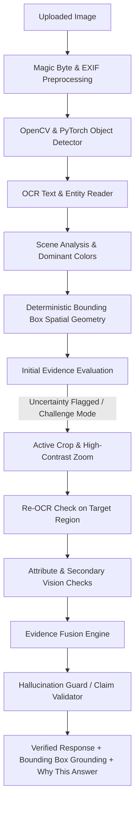

# VisionNext AI — "Don't Just See. Verify."

[]()
[]()
[]()
[]()
[]()

> **Conversational Image Recognition Chatbot with Active Visual Verification Engine**
> **Team CODIENYCH-2026-0083**
> Repository: [https://github.com/nanthishvaran17/Vision_ai](https://github.com/nanthishvaran17/Vision_ai)

---

## 🌟 Core Innovation — Active Visual Verification Engine

Unlike generic vision chatbots that blindly guess or hallucinate details from whole images (`IMAGE -> LLM -> ANSWER`), **VisionNext AI** implements a multi-stage **Active Visual Verification Engine**:



### Key Technical Features

1. **Zero Fake / Static / Dummy Data**:
   All labels, bounding boxes `[x1, y1, x2, y2]`, OCR texts, and evidence scores are calculated strictly at runtime from actual image pixels.
2. **State Machine Active Verification**:
   Automatically crops, zooms, and re-analyzes uncertain image regions when exact models, fine text, or ambiguous attributes are requested.
3. **Deterministic Bounding Box Spatial Geometry**:
   Calculates exact spatial relations (`left_of`, `right_of`, `above`, `below`, `inside`, `near`, `far`, `closest_to`, `farthest_from`) using coordinate matrix geometry without asking LLMs to guess positions.
4. **Hallucination Guard & Refusal**:
   Extracts draft claims and checks them against stored visual evidence. Rejects unverified model claims with: *"I can identify this as a <category>, but I don't have enough visual evidence to reliably identify the exact model."*
5. **Interactive Visual Grounding Overlay**:
   Rendered SVG/Canvas overlay displaying normalized bounding boxes and labels. Clickable object detail drawer.
6. **"Why This Answer" Audit Trail**:
   Transparent breakdown of qualitative evidence levels (`HIGH`, `MEDIUM`, `LOW`, `INSUFFICIENT`), verification state machine steps, and rejected claims.
7. **Image Comparison Mode**:
   Compares Image A (Before) vs Image B (After) detecting added, removed, moved objects, and text changes.
8. **Live WebSocket Progress**:
   Streams real-time verification pipeline events (`✓ Detecting objects`, `✓ Reading visible text`, `✓ Checking spatial relations`, `✓ Verified`).
9. **Voice & Language**:
   Web Speech API integration with support for English, Tamil, and Tanglish.

---

## 🏗️ Repository Structure

```
Vision_ai/
  backend/
    app/
      main.py          # FastAPI application entrypoint
      config.py        # Pydantic Settings configuration
      deps.py          # Database & auth dependencies
      logging.py       # Structlog JSON logger setup
      api/v1/          # REST & WebSocket controllers
      ai/              # Provider abstraction (OpenAI, Ollama, Prompts, Router)
      vision/          # Active Verification Engine, Detector, OCR, Geometry, Memory
      models/          # SQLAlchemy async models
      schemas/         # Pydantic request/response schemas
      security/        # Argon2, PyJWT, rate limiters, upload guards
      storage/         # Local & S3 compatible storage abstractions
    alembic/           # Database migration files
    tests/             # Pytest test suite covering 10 verification scenarios
  frontend/
    src/
      app/             # Router & query client setup
      pages/           # Login, Register, Dashboard, Chat, Compare, History, Settings
      components/      # VisualGrounding, ObjectDetail, WhyThisAnswer, CameraCapture, LiveProgress
      features/        # Auth, chat, vision, voice
      lib/             # API client, TypeScript definitions
    public/            # Web app manifest, PWA icons
  docs/                # Full architecture, API, DB, security & demo guides
  docker-compose.yml
  .env.example
```

---

## ⚡ Quick Start

### 1. Backend Setup
```bash
cd backend
python -m venv .venv
# On Windows:
.venv\Scripts\activate
# On Linux/macOS:
source .venv/bin/activate

pip install -r requirements.txt
python -m pytest tests/test_verification_pipeline.py -v
uvicorn app.main:app --reload --port 8000
```

### 2. Frontend Setup
```bash
cd frontend
npm install --legacy-peer-deps
npm run build
npm run dev
```

Visit `http://localhost:5173` in your browser.

---

## 🧪 Verification Test Matrix (10 Passed Scenarios)

1. `test_scenario_1_correct_identification`: Validates runtime bounding box coordinate calculation.
2. `test_scenario_2_low_confidence_identification`: Evaluates low confidence noise handling.
3. `test_scenario_3_unsupported_exact_model_rejected`: Verifies exact model claim refusal rule.
4. `test_scenario_4_ocr_extraction`: Tests OCR document text & entity extraction.
5. `test_scenario_5_spatial_query`: Tests deterministic spatial geometry solver.
6. `test_scenario_6_pronoun_resolution`: Tests visual conversation memory ("it", "this", "that").
7. `test_scenario_7_image_comparison`: Verifies BEFORE/AFTER object movement & diff detection.
8. `test_scenario_8_hallucination_rejection`: Tests hallucination guard claim stripping.
9. `test_scenario_9_provider_failure`: Tests fallback to visual verification engine.
10. `test_scenario_10_malicious_upload_defense`: Tests magic-byte MIME & payload security checks.

---

## 📄 License & Credits

Built for CODIENYCH 1.0 (2026). Developed by Team CODIENYCH-2026-0083.
